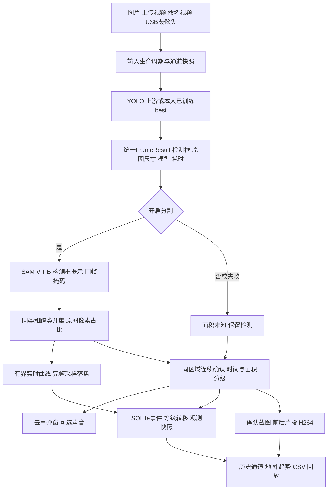
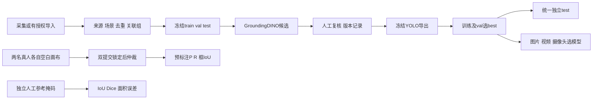

# 系统架构与处理流程

## 运行结构

|层次|主要模块|责任|
|---|---|---|
|网页与配置|Home、pages、inference_ui、monitoring_ui、configs|模型/分割/通道选择、展示与导出|
|输入与推理|video_runtime、camera_runtime、model_runtime、inference_result、segmentation|解码/设备释放、统一结果、同帧掩码与兼容旧接口|
|报警与历史|alarm、alerts、alarm_log、recording、trends、channels|区域连续确认、分级、媒体、趋势与历史快照|
|数据与实验|dataset_store、annotations、grounding_prelabel、training、comparison、experiments、quality|版本、复核、训练、统一评测、控制实验与质量工具|

## 数据和实验流程

正式test须保持来源隔离和人工参考独立性。辅助复核不等于独立标注。相同模型既用于预标注又用于对比时必须披露，不以模型掩码自动充当真值。

## 状态与持久化

视频暂停保留当前位置且不采样；摄像头暂停关闭设备，继续时重新打开并创建新观测段。运行或暂停时禁止切换输入与模型。停止、视频结束或设备异常关闭本段观测，不生成“火情恢复”结论。

报警数据库默认位于artifacts/alarms/alarms.sqlite3，媒体位于其同级media；趋势存入observation_samples。数据、训练、比较、实验及质量索引位于data/fire_dataset/catalog.sqlite3及对应子目录。模型下载在artifacts/models。整个数据根目录与报警数据库/媒体必须成套备份，先结束任务并关闭服务。旧记录缺失新字段时显示未记录，不能补造数值。
