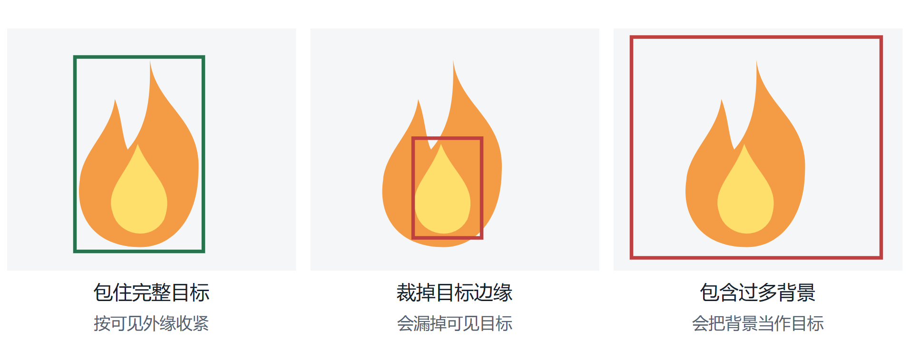
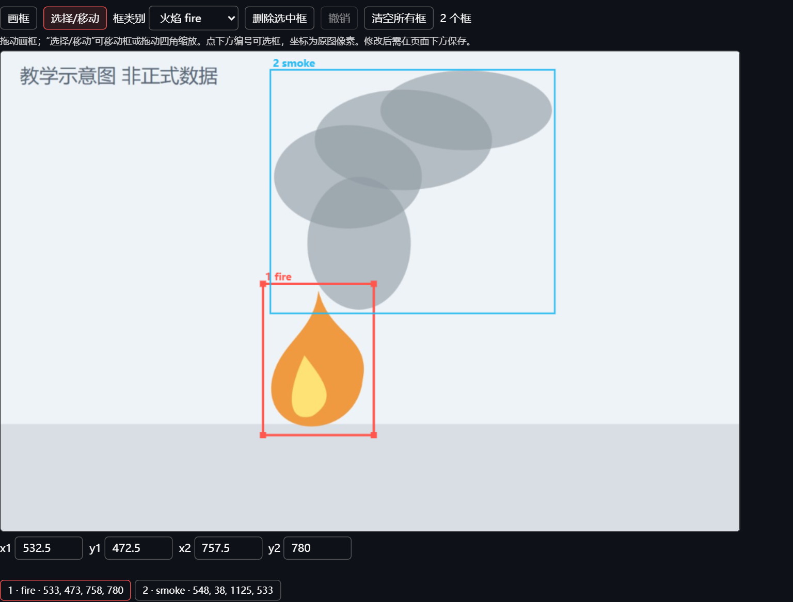
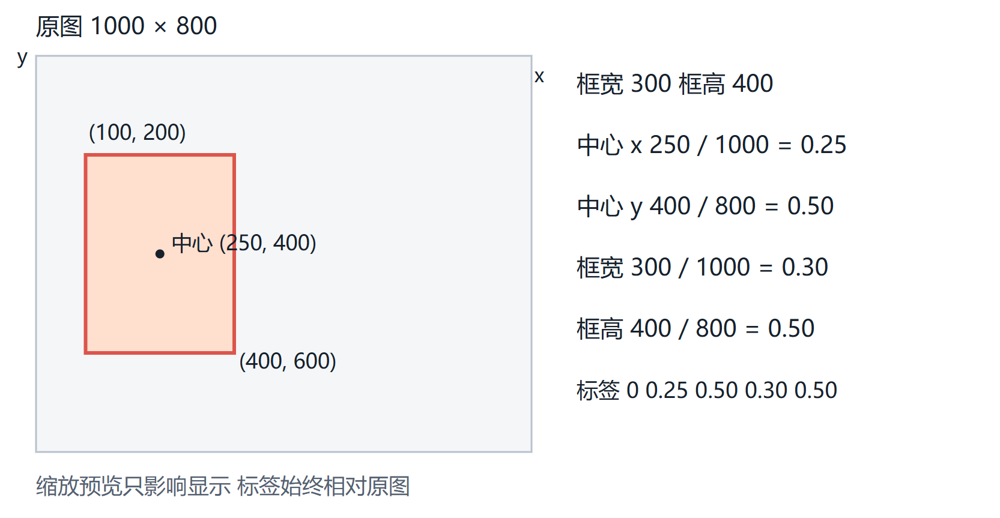

# 火焰烟雾数据标注操作手册

适用对象：本项目的人工标注与复核人员。编写日期：2026年10月23日。依据代码版本：317a26e。本手册用于统一fire与smoke的矩形框标注方法，并指导队友在现有网页中保存可追溯的真实人工记录。

**先领取任务再操作**。负责人必须说明你执行“模型辅助复核”还是“双人独立标注”，并给出图片清单。独立标注图片在提交前不查看模型候选、另一人的框或讨论逐图答案。练习图片与正式独立任务分开。

2026年10月24日已建立同一台电脑轮流完成的200幅正式独立任务。该任务的固定入口、本人访问码文件、进度和提交方法，以[200幅任务操作指南](dual_annotation_200_guide.md)为准；无需重新创建任务。当前Quality已增加待办筛选、退出会话及可视化仲裁，旧版Word手册中JSON仲裁的操作已由下述画布方式取代。

## 1 本轮要标什么

当前整理了700幅图像，其中500幅为来源声明中的火烟场景，200幅为D-Fire正常候选。所有图像还需本人检查，自动候选为空的29幅正样本应优先核查。项目已导入这些素材，日常无需重新上传或重新运行全量预标注。

本轮还有300段共15分钟的视频，是从46个原视频截取的非重叠片段。现有Annotations和Quality标的是静止图像，不是在视频时间轴逐帧画框，也不记录事件起止时刻。若需新增视频关键帧，由负责人抽取、保留原视频来源，并保持同源组划分；不要把每一帧都导入来凑独立样本数。

|任务|去哪里操作|是否能看模型框|保存后的含义|
|---|---|---|---|
|模型辅助复核|Annotations → 人工复核|能，需要逐个核查|草稿或人工通过版本，可按规则导出训练标签|
|双人独立标注|Quality → 独立标注|不能，从空白画布开始|本人提交后锁定，供两人完成后的质量比较与仲裁|
|人工仲裁|Quality → 管理与仲裁|两人全部完成后由管理者查看|人工参考版本，用于质量报告，不自动变成Annotations通过版本|

两个人分别在Annotations修改同一个模型框，不等于两人独立标注。题目要求的200幅双人标注，应由两名真人分别标同一批不少于200幅图片，而不是一人100幅不同图片。

## 2 类别与正常场景的定义

本项目训练导出固定使用 **0=fire，1=smoke**。正常场景没有“normal类别框”；整张图确认没有这两类目标后，对应标签文件为空。

|画面内容|本轮采用的处理规则|
|---|---|
|能够确认的可见明火|标fire；蜡烛 炉火 受控燃烧等有真实明火时也标，是否危险另由应用判断|
|能够确认的燃烧烟雾或本次入选实验发烟装置烟雾|标smoke；白 灰 黑颜色均可能出现，以可见烟雾形态和已核实来源共同判断|
|同一位置既有明火又有烟|分别画fire与smoke，两个框可以重叠|
|夕阳 灯光 车灯 反光 红色物体|不因颜色亮或红就标fire；若整图无目标，按正常确认流程处理|
|云 雾 蒸汽 扬尘|不直接标smoke；无法区分时保留疑难，不强判为烟或正常|
|烟花 火花 焊接亮点 阴燃红点|是否纳入fire需负责人预先统一；当前没有额外类别，也不能仅凭亮点证明早期火灾|
|旧模型框 文字 水印|它们本身不是fire或smoke；如存在检测覆盖层污染，交负责人筛除或更换素材|

先看整幅图，再看目标局部。正常判断要求检查所有区域，不能因为模型没有出框就勾选无目标。来源声明写了fire也不保证每一帧真有火；画面与声明矛盾时先保存草稿并反馈。

关于燃烧阶段，远处的小火焰不能直接认定为早期小火星，浓烟外观也不单独证明充分燃烧。矩形框标注只描述可见目标；场景与燃烧阶段统计由负责人另行核验。

## 3 矩形框的统一画法

### 目标边界

矩形应包住目标可见区域，尽量贴近最左、最上、最右和最下边界。不要把整座房子、树林或天空都包进去，也不要只框火焰中心最亮的一小块。图像没有提供的遮挡内部或画面外区域不凭想象补全。

火焰通常按同一燃烧源、同一连续可见火焰团画一个框；明显分离的独立燃烧源分别画。不要把每个火舌都拆成许多框，也不要跨很大背景空隙把独立火点合成一个框。

烟雾通常按同一可辨认烟羽的连续可见外缘画框，包含能够确认的半透明部分；边界弱到与背景无法区分时，不无限扩张。烟羽延伸出画面，就框到图像边缘。多个分开的烟羽分别画；无法确定是否同一目标时按疑难提交统一裁定。

### 重叠与遮挡

同一个目标不要保留多个几乎重合的同类框。火焰框与烟雾框可以重叠，因为它们描述不同类别。透明烟雾前方仍看得到火时，两类都要检查。被遮挡目标只依据可见部分判断，同一目标可见片段之间的遮挡空隙可被外接框包含，但不要猜测不可见目标的完整外形。

若小目标仅是一两个模糊亮点，先放大原图检查；无法判断就保存疑难。程序允许至少1个原图像素宽高，只是格式校验下限，不表示每个1像素亮点都应当标注。



上图为合成教学图，展示完整包围、裁切目标和背景过大的区别，不属于正式数据或人工真值。实际烟雾边界有模糊性，最终应遵循负责人统一的边界口径。

## 4 模型辅助复核的完整操作

### 打开任务与核对图片

1. 在项目电脑访问http://127.0.0.1:8501，从侧边栏进入Annotations。若服务未启动，在D:\GPTWORK\fire-alarm-system双击“启动项目.cmd”。保留启动窗口。
2. 在“执行者/复核者姓名或编号”填写本人稳定编号，例如队友姓名或成员B；不要多人共用“管理员”。此字段只是署名记录，不是账号登录。
3. 选择“人工复核”，在“复核图片”下拉框中搜索负责人给出的文件名或图像ID前缀。核对原图和任务清单，再开始编辑。
4. 首次进入通常会载入候选或最新人工版本。如果负责人要求某个候选版本，选择“预标注版本”后点击“采用所选预标注”。这个按钮会重置当前未保存画布，点击前先保存重要修改。

本轮已经生成候选。队友日常无需在“自动预标注”修改提示词或阈值，重复运行也不等于人工完成。如果页面提示模型失败，它与真实无目标是不同状态。

### 修改与核查

5. 先看整幅图，逐个核对已有框的类别、边界、重复和遗漏，再处理小目标、透明烟雾、边缘区域和干扰物。模型分数高也要检查。
6. 漏标时点“画框”，从目标左上角向右下角拖出矩形。新框完成后保持选中，再核对“框类别”，必要时改成fire或smoke。改变类别会作用于当前选中框，不能以为只是在设置下一次画框的默认值。
7. 调整边界时点击框下方编号选中，再用“选择/移动”拖动整个框或四角。边界不易拖准时输入x1、y1、x2、y2，确认坐标属于原图且x2>x1、y2>y1。
8. 选中误检或重复框后点“删除选中框”。误操作可点“撤销”，最多保留最近25步；“清空所有框”会移除当前画布的全部框，不能代替整图检查。



截图来自当前程序的独立教学工作区，图像与候选为教学构造，不写入本轮正式标注。红框表示fire，蓝框表示smoke；实际操作还须结合画布下方的说明与保存按钮。

### 保存状态

9. 在“复核/修改说明”写出真实处理内容，例如“删除右上角灯光误检，补充左侧白烟并收紧火焰下边界”。没有改动时可写“逐框核对类别和边界，检查整图无遗漏，保留候选”。避免只填“完成”。
10. 尚有疑问就点“保存草稿”；类别、边界和漏标都核对完成才点“确认复核通过”。画布上的修改不会仅因切图自动成为人工通过记录。
11. 保存后检查成功提示和“人工修改记录”，确认署名、状态与说明正确，再切换下一幅图片。需要交接时下载“此图完整修改记录”，或按负责人约定登记图像ID与版本。

未保存画布依赖当前浏览器会话，刷新、断开或重启不保证保留。“重新载入已保存版本”会放弃当前未保存编辑。若提示其他窗口已更新，先保存自己的文字备注到交接记录，再重新载入最新版本，不要用旧窗口覆盖。

## 5 正常负样本与空候选的处理

### 确实没有火焰和烟雾

逐区域检查后，若整图确实没有fire或smoke，删除所有误检框。当前画布为空时才会出现“我已检查整张图，确认没有 fire 或 smoke”。填写检查说明，勾选该项，再确认复核通过。导出时生成一个与图像同名的空TXT文件。

不要给正常画面画一个“normal大框”，也不要写“2 0 0 0 0”来表示正常。空TXT是已核实正常图像的合法结果；缺少TXT则不是同一回事。

### 模型没有检出但画面有目标

本轮29幅来源正样本没有候选框。应按照原图手动补出可确认的fire或smoke，再写清“补充模型漏检”。不能为了让按钮可点击而勾选无目标。

如果经仔细检查仍确实无火烟，或者看不清是否有烟，先保存草稿并反馈负责人。确认无目标可能使原先“500幅火烟图像”的数量需要重算和补足，必须连同来源场景声明一起处理。200幅正常候选若发现真火或真烟，也应反馈，不能为保持200幅数量保留错误标签。

### 看不准的样本

记录疑难位置和原因，例如“远处山脊灰白区域，烟雾与低云无法区分”。不把不确定烟雾一律画框，也不把它们一律批准为负样本。当前只有fire和smoke两类，不能私自新增unknown框；未决状态通过草稿和说明保留。

## 6 双人独立标注的完整操作

### 由负责人先准备

负责人在Quality选择“创建独立标注任务”，指定同一批图片、两名真实标注者A与B和任务管理者。系统生成三种访问码，分别交给对应人员，不把管理码或另一人的访问码混发。正式任务至少覆盖200幅同一批真实图像，练习与合成教学图不计入。

独立任务从空白画布开始。参与者提交前不在Annotations、截图、标注文件或聊天中查看这些图片的模型框和另一人的答案。已看过候选的情况必须如实说明；可以由负责人更换未看过的素材或披露限制，不能通过换编号来宣称未看过。

### 标注者实际操作

1. 进入Quality，选择“独立标注”，输入自己的“独立标注访问码”。核对页面显示的本人身份。
2. 保持“仅显示尚未提交的图片”勾选，在“本人的待标注图片”按Q编号选择图片。画布没有预标注，依据本手册从头画框；页面显示本人的完成进度。
3. 点击“开始或继续工作计时”后开展检查和画框。需要休息、讨论或离开时点击“暂停工作计时”。页面空闲超过60秒停止累加，但这不能替代本人主动暂停。
4. 完成后，检查类别、边界、遗漏与重复。确实无目标时勾选“独立检查后确认整图无fire/smoke”。看不准时先不要提交锁定，记录问题交负责人安排；不要通过交流逐图框位置解决独立任务。
5. 点击“暂停工作计时”。只有累计计时大于0且当前计时已暂停，提交按钮才可能可用；不要伪造秒数来绕过。
6. 点击“提交并锁定本图独立标注”，确认“此图已独立提交并锁定”，再处理下一幅。提交前最后检查，独立提交后没有普通的回退重改按钮。

待办筛选会移除已提交图片。交接电脑前点击“退出本次独立标注”，关闭私人浏览器窗口；另一人重新打开私人窗口并使用本人访问码。服务器保存已经提交的记录，原访问码可供以后继续。

**保存方式与Annotations不同**：独立页面没有“保存草稿”按钮，未提交框与计时只在当前会话，服务重启会丢弃。尽量一次完成一幅，提交后再关闭。长期疑难图由管理者安排后续处理，不在不了解规则时直接锁定答案。

任务较大时可由负责人事先分成多个小任务，例如10个任务各20幅，两人对每个任务都独立完成；总计仍需至少200幅不重复图像。管理员须等某个任务的两名参与者都完成该任务全部图片后，才能查看其结果与仲裁。

## 7 仲裁 质量报告与工时

仲裁由负责人或指定管理者执行。进入Quality的“管理与仲裁”，输入管理码；两人全部完成前页面不展示框。完成后对照原图和两份标注，逐项判断漏标、误标、类别和边界争议，填写人工仲裁说明并保存人工参考版本。

当前仲裁页面显示A/B两份带框预览，使用“人工仲裁参考画布”修正。默认起始使用已保存参考或A的框，只为方便编辑，不代表A是真值。填写说明并保存人工参考后，再勾选确认并点击“确认此仲裁参考用于训练”，才追加Annotations人工通过版本；空参考还须明确无火烟确认。A/B原始提交保留。JSON仅作为坐标查看，不再要求初学者手工编辑。

质量报告会比较框的匹配IoU与未匹配目标，并将固定预标注与人工参考比较得到Precision、Recall等。它用于发现规则和候选问题，不能用“框看上去差不多”代替实际报告。仅保存Quality参考不会自动通过；负责人须逐图明确确认用于训练，最终导出会检查人工通过标签与最新仲裁一致。

Annotations里的编辑页停留秒数包括空闲，不能直接当人工有效工时。Quality活动计时只是辅助记录，也不能自动证明每秒都在认真工作。若题目需要节省工时，应比较实际测量的纯人工与辅助复核任务，控制任务难度、质量标准和先后顺序，由负责人记录；结果可能没有节省，不能预填结论。

## 8 YOLO标签怎样对应图像

每幅图像对应同名TXT，一行一个框，顺序为：

```text
class_id x_center y_center width height
```

后四项是相对于**该幅原图**宽高的0至1小数，不是像素坐标，也不是相对于网页预览尺寸。类别0为fire，1为smoke；边界框使用可见目标的外接矩形。

假设原图宽1000像素、高800像素，fire框左上角为(100,200)，右下角为(400,600)。框中心为(250,400)，宽300、高400。除以原图对应宽高后得到：

```text
0 0.250000 0.500000 0.300000 0.500000
```

你在网页中操作的是原图像素坐标，程序负责归一化，不需要自己手算和手改TXT。上述数字只用于理解格式。框的宽高必须大于0且完全位于图内；数值不合法会阻止保存或导出。



**类别映射务必核对**。本项目导出0=fire、1=smoke；D-Fire原始正标签顺序相反，不能直接合并。当前待复核包中已经按项目格式生成候选，但候选格式正确不代表内容正确。

## 9 负责人怎样导出与备份

日常队友只需完成保存和交接，下面的导出由负责人统一执行，避免多份数据各自修改。

1. 在Annotations选择“YOLO导出”，确认最新版本已人工通过。仅有旧通过版本但后来又保存草稿的图片，也不应沿用旧状态当作完成。
2. 若只需要标签与审计文件，使用“导出已复核标签 ZIP”。这个包不含图像，不能单独拿去训练。
3. 若用于训练，选择已有的当前分组划分，确认该划分全部图像复核完成，点击“生成YOLO训练数据集”。保留images、labels、data.yaml、来源划分快照和审计文件。
4. 图像总量超过128MB时，页面只生成本机训练目录，不额外在网页内存中打成ZIP；这是正常行为，不表示导出失败。负责人使用页面显示的完整目录。
5. 结束任务并关闭服务后，成套备份data/fire_dataset，包括数据库、原图、划分、复核与导出。Git提交代码不会备份这些数据；不要只拷一份TXT目录或一个正在使用的数据库文件。

本轮“最低数量数据集_700图_300视频_待复核.zip”是候选交付包，不是正式已复核训练集。完成网页复核后，应重新从系统导出；原始候选包不会自动更新成你的人工版本。

## 10 每幅图片的自查清单

- 我检查了整幅画面，尤其是角落、小火点、透明烟雾和图像边缘。
- fire与smoke类别正确；两者并存时分别标注，没有漏掉其中一类。
- 框包住可确认的可见目标，边界不过度外扩，也没有裁掉主要部分。
- 没有同一目标的重复同类框，没有把云、灯光、水印或旧检测标记当目标。
- 当前模式、本人身份和图片编号正确，疑难原因已如实记录。
- 辅助复核已保存草稿或通过；独立标注已暂停计时并提交锁定。
- 未把模型空结果直接当正常；没有为了完成数量私自改变标注规则。

### 负责人验收建议

先对10至20幅练习图逐张讲评，统一火焰团划分、烟雾外缘和干扰物规则，再开始正式任务。正式辅助复核可抽查每批约10%，同时全查空标签、原29幅空候选正样本和疑难图；10%是协作建议，不是题目规定，也不是已达到的质量水平。发现系统性错误时回查整批。

两名参与者的独立提交与仲裁另行保留，至少200幅必须来自真实任务，不能用合成教学截图、自动化测试角色、复制同一份框或同一人更换名字替代。

## 11 常见问题与交接记录

|遇到的情况|处理方法|
|---|---|
|辅助复核通过按钮灰色|检查本人编号和修改说明；空画布还需明确无目标确认，不能用勾选绕过漏标|
|独立提交按钮灰色|检查计时已开始且累计大于0，并已暂停；空画布需独立无目标确认|
|找不到分配图片|核对文件名或ID前缀及当前数据目录，向负责人确认；不要重新导入一份凑数|
|画框后切图内容丢失|画布不等于已保存；辅助模式先保存，独立模式完成后提交再离开|
|框类别意外变化|下拉框会修改选中框；用撤销恢复，选中目标后逐个核对类别|
|提示其他窗口更新|由负责人确认谁负责该图，再载入最新保存版本，避免旧窗口覆盖|
|模型候选或网页未加载|保留报错文字与图片编号交负责人，失败不能当无目标|
|独立任务提交后发现错误|告知管理者，保留原提交；通过仲裁或明确新任务记录处理，不伪造原始独立结果|

每次交接至少记录以下字段，可复制到双方约定的工作记录中：

|字段|填写内容|
|---|---|
|日期 标注员 任务类型|例如2026年10月23日 成员B 模型辅助复核|
|任务编号和素材范围|负责人分配的任务ID 文件名或图像ID清单|
|本次处理与未完成数量|分别填写草稿 通过 独立提交和待处理数量，不混为“已完成”|
|疑难图片与原因|逐图登记ID 位置 疑问，需要决定的类别或边界|
|有效工作时长|只填实际测量值，并说明计时方法；未测量写未记录|
|交接和复查|交给谁 哪些图片需复查，实际保存或导出位置|

本手册根据当前Annotations、Quality及box_editor的实际按钮与保存逻辑编写。它统一的是工作方法；标注准确性、双人独立性和真实工时仍需要参与者认真执行，并由负责人检查和记录。
