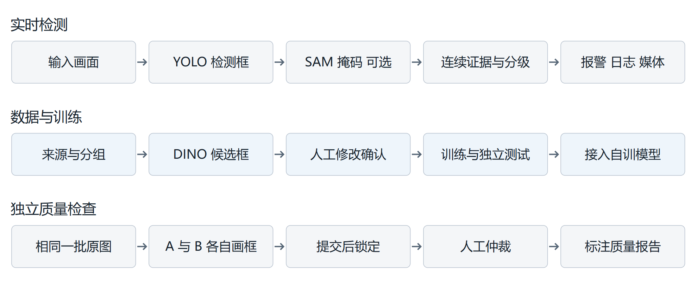

# 智能火灾报警系统项目入门手册

适用对象：刚加入项目、没有计算机视觉基础的队友。编写日期：2026年10月23日。依据代码版本：317a26e。本手册帮助你解释系统怎样工作、找到对应实现，并能配合负责人完成数据工作。

先通读第1至第4章，理解检测、分割、报警和训练的区别；再到项目电脑上完成第8章的试用。正式开始标注前，阅读配套《火焰烟雾数据标注操作手册》。不要求你先学会编程，也不要求你独自安装模型或修改系统配置。

## 1 项目要解决什么问题

系统接收图片、视频或USB摄像头画面，识别可见火焰与烟雾；连续观察到同一区域的有效证据后，显示关注、预警或报警，并保存截图、录像片段和历史日志。后续还可以使用人工复核的数据训练自己的检测模型。

你可以用下面这段话向别人介绍项目：“我们使用YOLO检测画面中的火焰和烟雾，用SAM估计其在画面中的像素占比，再结合连续帧和持续时间分级报警。系统保存报警证据，并提供数据管理、标注、训练与对比评估工具。”

**当前实际进度**：系统功能与实验工具已经接通；2026年10月22日整理了500幅火烟场景图像、200幅正常场景图像，以及300段合计15分钟的视频。图片目前均需人工确认，29幅已选正样本的自动候选框为空。正式训练、独立测试、200幅双人独立标注、实际面积误差和优化效果尚未完成。这里的数量是整理记录，完成标注后还要重新核实类别。

本轮按用户已告知的教师认可口径，将公开无框标注视频的自主选片、剪辑和抽帧计入自行采集；原始来源始终记为公开素材，不能写成队员亲自拍摄。早期小火星和严格燃烧阶段覆盖仍须确认。

### 先认识这些词

|词语|在本项目中的含义|
|---|---|
|帧|视频中的一幅静止图像；300段视频不等于300帧|
|检测框|用矩形指出目标在哪里，同时给出fire或smoke类别|
|掩码|与原图对齐的像素区域，比矩形框更细，用于统计画面占比|
|置信度|模型给某次判断的分数；0.8不能直接解释为80%的真实正确率|
|标签与人工参考|人对图像给出的类别和框，是训练和评估的重要依据|
|权重|模型学到的参数文件，通常为.pt或.safetensors；与程序代码不同|
|推理与训练|推理是用现有模型处理新图；训练是用带标签数据更新模型参数|

## 2 整体框架与两条主要流程

项目使用Python处理数据和运行模型，使用Streamlit把功能做成浏览器页面。页面、模型推理、报警判定和数据库各有分工，用户在网页上操作，本机程序负责计算和保存。日常标注不需要把图像上传到外部推理服务。



**运行检测的流程**是：读取画面 → YOLO输出框 → 按需用SAM分割 → 计算面积占比 → 累计同区域证据 → 更新报警 → 保存日志与媒体。图片页主要用于看单幅结果；连续确认与事件录像主要发生在视频和摄像头观测中。

**改进模型的流程**是：整理来源与采集组 → 冻结训练验证测试划分 → GroundingDINO提出候选框 → 人工修改与确认 → 导出YOLO数据集 → 训练 → 独立评估 → 在检测页选择成功训练的模型。标注质量会直接影响后续训练，因此队友的主要贡献是准确标注和记录疑难问题。

还有一条独立的质量流程：两名真人在Quality从空白画布分别标注同一批图像，两人提交后再比较和仲裁。这条流程用来检查标注一致性和预标注质量，与看着模型框进行修改的日常复核分开执行。

## 3 三个模型分别负责什么

|模型|输入和输出|在项目中的用途|
|---|---|---|
|YOLO|图像 → 类别 矩形框 分数|图片 视频 摄像头的常规火烟检测；可用复核后的数据训练|
|GroundingDINO|图像和文字提示 → 候选框|用fire和smoke等提示词生成预标注；也用于独立对比工作区|
|SAM ViT B|图像和检测框提示 → 像素掩码|在现有框内尝试分出火烟像素，用于画面占比；本项目不训练SAM|

### YOLO为什么能画出框

模型先把图像转换成特征，再预测多个目标的类别、位置和分数。推理过程会滤掉低于阈值的候选，并用NMS减少同一目标的重复框。NMS比较框的重叠情况，不等于连续帧报警，也不等于人工把目标描出来。

IoU表示两个区域交集面积除以并集面积。两个框完全重合时IoU为1，完全分离时为0。项目在不同位置使用不同IoU阈值：删除重复框、前后帧关联和评测匹配的目的不同，不能因为名称相同就随意设成同一个数字。

模型识别的是可见外观。火焰可能呈黄色、橙色或其他颜色，烟雾可能是白色、灰色或黑色；夕阳、灯光、云、雾和蒸汽都可能造成混淆。框上写了fire，也仍有可能是误检。

### GroundingDINO为什么只能作为候选

本项目用英文提示词分别寻找火焰和烟雾，并记录模型版本、提示词、阈值、输入哈希和耗时。模型可能把反光当火，也可能漏掉透明烟雾。人工需要补框、删框、调整边界和改类别；模型输出为空不能直接批准成正常负样本。

### SAM为什么还需要检测框

本项目先用YOLO定位，再把框作为SAM提示。检测漏掉的目标通常不会被这条分割流程补出来；检测框位置错误也可能影响掩码。SAM给出的区域仍是模型预测，不是人工参考真值。训练用的YOLO矩形框与面积误差用的人工像素掩码是两种不同标注。

## 4 面积与分级报警怎样工作

火焰占比等于火焰掩码有效像素数除以原图像素数。若1000×800的图像中火焰并集为24000像素，占比就是3%。同类多个掩码先合并，火烟总占比也按并集计算，重叠像素只计一次。这里表示画面中的比例，没有标定就不能换算成平方米或实际蔓延速度。

分割关闭、模型缺失或本帧分割失败时，面积为未知。未知不等于0，也不能把上一帧的面积直接沿用到当前帧。无目标且分割流程有效的情况才可以报告零面积。

|判定条件|本项目演示默认设置|
|---|---|
|连续证据|相同类别、能够关联的区域至少连续3帧；还要满足持续时间|
|报警使用的置信度|fire和smoke均为0.50，与检测显示阈值分开|
|按时间进入关注 预警 报警|分别持续0.5秒 2秒 5秒|
|面积辅助升级|区域占比达到3%持续1秒可预警，达到10%持续2秒可报警；仍须连续确认|
|恢复等待|有连续观测且证据不再支持时，等待2秒再降级或恢复|
|相邻帧最大时间间隔|默认1秒；间隔过大会中断连续证据|

这些是可调整的课程演示参数，不是已在正式独立测试上证明最优的阈值。小面积但持续存在的火情仍能按时间规则报警。烟雾也能独立参与报警，不要求一定同时有火焰。

视频报警使用素材时间；摄像头使用观测时钟。视频暂停不会继续累计；摄像头暂停会释放设备，继续后创建新的观测段并重新确认。停止、视频结束、断流表示观察结束，不能写成火情已经恢复。

确认事件后可保存截图和前后片段，默认窗口为确认前5秒、后10秒。素材开头、结尾或提前停止时可能不足完整窗口，以实际保存状态为准。历史页把事件、等级变化、通道位置快照、曲线和媒体关联起来；位置与视角是模拟配置。

## 5 实现方法与代码位置

这一章用于你和负责人讨论代码时找到位置。你不必现在修改这些文件；先知道输入、处理和保存分别在哪里即可。

|位置|具体责任|
|---|---|
|1_🔥_Home.py 与 pages/|浏览器页面；收集输入参数并展示结果|
|model_runtime.py 与 inference_result.py|加载和复用检测模型；组织当前帧结果|
|video_detection.py 与 camera_session.py|处理视频帧与摄像头观测，控制暂停 停止和释放|
|segmentation.py 与 trends.py|SAM分割 同帧面积和趋势记录|
|alarm.py 与 alarm_log.py|连续证据与等级规则；持久保存事件和历史|
|recording.py 与 channels.py|报警媒体保存和命名通道配置|
|dataset_store.py 与 annotations.py|素材来源 去重 分组划分 复核版本和YOLO导出|
|grounding_prelabel.py 与 quality.py|自动候选与独立标注 质量和工时工具|
|training.py comparison.py experiments.py|训练 统一评估和优化对照；保留各次实验版本|

### 一帧结果如何传递

FrameResult把原图rgb、图宽高、detections、类别计数、模型信息和timing_ms放在一起；开启分割后增加masks和分割状态。这样图片、视频与摄像头可以复用相同结果格式。面积计算直接读取同一帧的布尔掩码。

下面只描述处理顺序，是解释原理的伪代码，不是可以复制运行的接口：

```text
读取当前帧
调用检测模型 得到原图坐标中的框
若启用分割 则用这些框提示SAM
记录当前帧面积 或明确记录未知
更新连续区域与报警等级
必要时保存事件 截图 片段和趋势
```

模型预处理可能缩放和填充图像，页面及导出的框必须对应原图。当前YOLO接口已经返回还原后的原图坐标，不要再自行缩放一次。训练时的640输入尺寸也不意味着把标注坐标直接除以640。

### 数据怎样保存

SQLite是本机数据库文件。数据目录中的catalog.sqlite3关联素材、复核版本、划分与实验；报警目录中的alarms.sqlite3保存观测和事件。修改框会追加人工版本，导出会冻结当时的版本，不用新结果覆盖旧记录。负责人能追溯谁在何时改了什么。

## 6 标签怎样变成可用模型

YOLO训练至少需要图像、每幅图像对应的TXT框标签，以及说明类别与目录的data.yaml。本项目固定0=fire、1=smoke。D-Fire原始编号通常为0=smoke、1=fire，顺序相反；本轮只用了其正常空标签，后续引入正标签时必须核对映射。

人工复核全部通过后，负责人在Annotations导出完整训练目录，再到Training设置训练轮数、图像尺寸、batch、学习率和设备。batch是一次计算使用的图片数量；epoch是一轮完整遍历训练数据。程序保存参数、损失曲线、验证指标及best和last权重。轮数增加不保证效果一直变好。

train用于更新权重，val用于选择模型和调参数，test用于最后的独立评估。同一原视频的相邻帧放进不同集合，模型可能只是记住背景，成绩会失真。因此相同原视频及已知同场景按组隔离，不能为了凑比例把一个视频拆散到三个集合。

本轮图像划分为484/140/76，约为69.14%/20%/10.86%。视频划分为210/24/66；整组隔离导致它不等于7∶2∶1。300段剪辑来自46个原视频，不应报告为300起独立火灾。

|评估词语|用普通话理解|
|---|---|
|Precision|预测出来的目标中，有多少与人工参考正确匹配|
|Recall|人工参考中的目标，有多少被模型找到了|
|F1|综合考虑Precision和Recall；需要同时说明使用的阈值|
|mAP|在规定匹配IoU与置信度排序下汇总检测效果；不是普通分类准确率|
|IoU与Dice|可用于比较像素区域；需要独立人工参考掩码|
|误报事件与报警延迟|对完整视频事件的评估，不能只用单幅框指标代替|

Comparison使用统一尺寸、设备和指标规则比较YOLO与GroundingDINO。Experiments提供固定尺寸与多尺度训练的成对配置，以及单帧和连续确认的策略对照。只有运行正式实验后才能填写差值，不能提前写优化一定有效。

成功训练且校验通过的best权重会出现在检测页的自训模型列表。训练完成只表示计算完成，还需要通过独立测试判断能否使用；当前整理记录中尚无本轮正式训练成绩。

## 7 网页功能与队友的职责

|页面名称|你需要知道的用途|
|---|---|
|Home|单幅图片检测；可选分割与掩码下载|
|Demo Images|图片画廊，不是数据标注页|
|Demo Videos|视频与USB摄像头检测 分级报警 录制和曲线|
|Alarm History|查事件 日志 截图 片段 趋势和历史位置|
|Dataset|素材来源 数量 场景声明和分组划分|
|Annotations|自动预标注 人工辅助复核 YOLO导出|
|Quality|双人独立标注 仲裁 面积误差和工时对照|
|Training|已复核数据的YOLO训练与评估|
|Channels Comparison Experiments|通道配置 模型对比和成对实验，初期由负责人操作|

你先承担两件事：按分配清单认真标注，记录看不清或规则不一致的图片。负责人负责冻结正式任务、管理版本、处理疑难样本、导出数据与训练。学习阶段先标10至20幅练习图，再与负责人逐张核对，统一规则后才开展正式任务。

正式双人独立任务需要两名真实参与者，通常由你和负责人分别完成同一批不少于200幅图片。不能各标100幅不同图片来代替200幅双人标注。练习图应避开正式独立任务图片，防止提前看到候选答案。

## 8 第一次上机操作

### 使用已经配置好的项目电脑

1. 打开D:\GPTWORK\fire-alarm-system，双击“启动项目.cmd”。保留启动窗口；浏览器访问http://127.0.0.1:8501。若页面已经运行，直接打开即可，不重复启动。
2. 在Home查看一幅内置图片的检测结果。认识fire、smoke、矩形框和分数，暂不调整全局文件或运行训练。
3. 与负责人选一段现有视频，在Demo Videos开始检测，观察候选出现与报警确认之间的区别。完成后先停止，再离开页面。
4. 打开Annotations认识执行者输入框、人工复核和画框工具；先用负责人提供的练习素材，按配套手册完成一轮演练。
5. 领取正式任务类型和素材清单。若领取Quality独立任务，先使用本人访问码，避免进入这些图片的模型候选页面。

127.0.0.1指当前这台电脑。队友在另一台电脑输入同一地址不会连到你的项目。初期建议轮流使用项目电脑；如需远程协作，由负责人配置统一访问方式。当前程序没有普通账号与完整权限体系，不要自行公开服务或分享管理访问码。

### 换电脑时由负责人准备

代码仓库不包含本轮700幅图像、标注数据库、下载的SAM和DINO权重及实验数据。只克隆GitHub仓库会缺少这些本机资料。负责人应按quick_start准备Python 3.11环境、依赖与模型，并在关闭服务后成套迁移数据目录；不要直接复制.venv作为新电脑环境。

## 9 数据目录与协作约定

|项目内位置|用途与协作要求|
|---|---|
|docs/|操作说明与设计文档，可用于学习|
|configs/|默认规则与配置；标注期间不随意修改|
|data/public_sources/|完整公开原始包与下载凭据，保留备查|
|data/minimum_collection/|筛选清单 联系表及待复核数据包；以最终清单计数|
|data/fire_dataset/|正在使用的素材 数据库 划分 复核和导出，备份时整体复制|
|artifacts/alarms/|报警数据库与媒体证据，备份时成套保留|
|artifacts/models/ 与训练目录|本机模型文件和实验权重，通常不随Git提交|

不要重命名原图、手改数据库、替换别人的catalog.sqlite3或删除划分来解决界面问题。两个人也不要把各自数据库文件互相覆盖合并；当前没有这种自动合并流程。相同图片的复核应分配给一人，其他人通过明确的复查安排进入，避免并发冲突。

普通Annotations中的姓名只是记录字段，不是账号认证；Quality访问码只是工作区隔离。若负责人已看过某批模型候选，后来再参加这批图片的独立标注，应记录这一事实，不能宣称严格未见过模型结果。

遇到看不清的烟雾、疑似反射、小亮点或来源声明与画面矛盾时，辅助复核先保存草稿；独立任务先保留疑难，不急于提交锁定。记录素材编号、问题位置和原因，交负责人安排处理。不要为了完成数量把不确定样本全部批准，也不要把它们全当正常。

## 10 每次工作结束前的检查

1. 确认自己执行的是辅助复核还是独立标注，使用了正确页面与身份。
2. 已处理图片都完成相应保存或提交；切换图片和关闭浏览器前检查状态。
3. 把疑难图片编号、未完成原因和需要负责人决定的规则写入交接记录。
4. 停止视频或摄像头观测，独立任务计时暂停；不要只关闭画面就认为数据已保存。
5. 告知负责人本次处理数量和待复查数量，由负责人抽查、备份；不自行开始正式训练。

完成入门后，你应能说明三个模型的分工，区分检测框与像素掩码，解释为什么需要连续确认，找到Annotations与Quality，并按同一套标准给火焰和烟雾画框。正式数据的人工结论、模型精度和节省工时都需要真实工作与实验记录支持。

### 继续查阅

本手册根据项目实际代码与配置编写，主要核对了pages/6_🏷️_Annotations.py、pages/11_🔬_Quality.py、components/box_editor/index.html、inference_result.py及相关默认配置。详细版本机制见docs/annotations.md，功能协议见docs/completion.md，当前数据来源和限制见docs/dataset_collection.md。旧阶段文档可能保留当时进度，应结合日期阅读。
