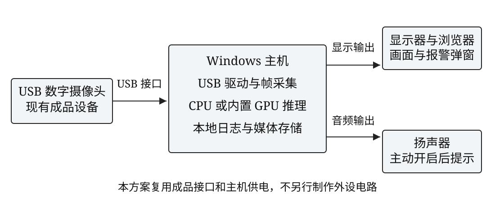
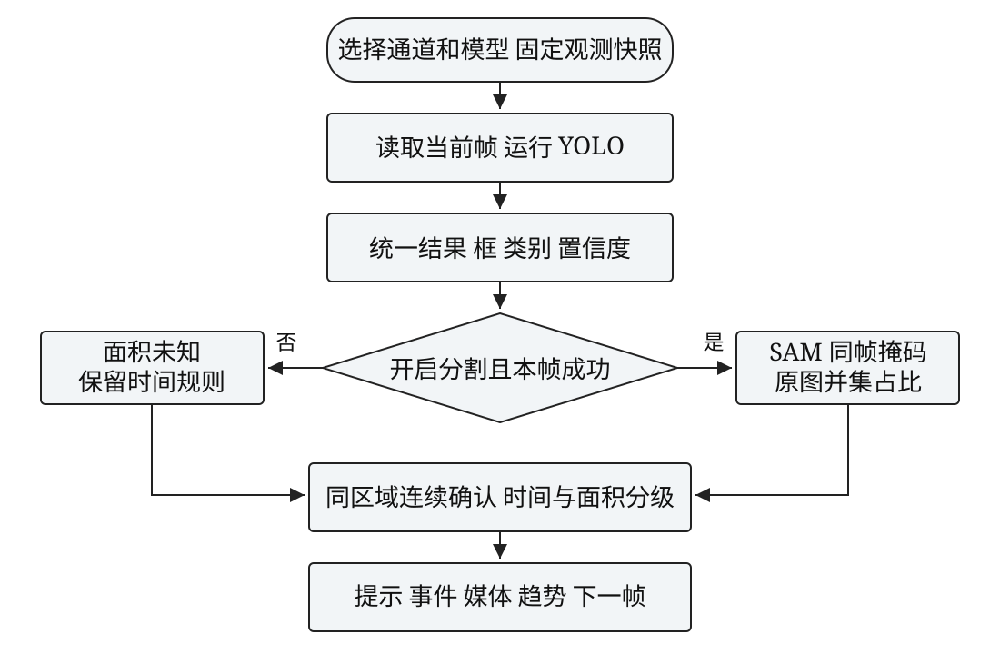

# 课题研究背景与意义

视频监控能够保留火灾现场的外观和变化过程，但仅依靠值守人员持续观察大量画面容易遗漏短时变化。面向实习原型，本项目将视觉检测、时序确认、报警联动和历史回看放在同一系统中，使一次告警能够追溯到输入来源、检测模型、发生位置和保存画面。这里的目标是完成可运行、可解释和可复现的实验系统，而不是声称已经达到工程消防产品的可靠性要求。

目标检测在单次推理中给出类别、置信度和空间位置。YOLO的统一检测思路为实时视觉提供了基础[1]，多尺度特征方法说明了目标尺寸变化对检测设计的重要性[2]。火焰和烟雾具有形状不规则、边界模糊、背景相似物多等特点，正常场景与火灾目标的比例也可能失衡。Focal Loss研究揭示的密集检测样本不平衡问题提示本项目应保留正常负样本并单独评价误报[3]；本项目没有据此修改YOLO损失函数。

只显示检测框无法提供像素区域。开放词汇GroundingDINO可根据文本提示产生候选框[4]，SAM可根据提示产生目标掩码[5]。本项目将前者用于自动预标注和独立对比工作区，将后者用于当前帧框提示分割。模型输出需要人工核验，特别是模型同时参与预标注时，辅助标签不能直接充当独立测试真值。

本系统基于已Fork的Wildfire Detection逐步扩展，保留上游代码和模型来源。新增内容涵盖逐帧视频与USB输入、模型切换、分割和面积趋势、连续确认与分级报警、截图和前后片段、通道地图以及数据和实验工具。COCO等公开评测工作强调了规范数据和统一协议的重要性[6]，因此本项目将数据来源、关联组划分、模型快照与结果校验作为实现的一部分。

截至2026年11月8日，700幅图片已由用户完成复核，保留同一200幅的A/B各200份原始独立标注。最终含火烟507幅、正常193幅，其中自主整理来源且含火烟495幅。300段视频合计900秒，来自46个公开原视频。固定尺寸和多尺度两组各50轮正式训练及同一冻结test评测已完成。严格自主火烟数量尚差5幅、正常图尚差7幅，候选另放待补，不混入本次冻结数据。辅助复核工时采用负责人实测约5秒/幅进行估算；现有框IoU用于定位一致性，分割IoU和面积误差仍待独立参考；报告封面身份暂不填写。公开原视频自主整理计自采采用教师认可的课程口径，保留原始public来源，不写成本人实拍。

从设计意义看，本项目把一次预测转变为具有观测上下文的事件。连续区域和持续时间规则可用于研究单帧触发的敏感性，面积信息可辅助分级，历史快照可解释“当时使用何种模型、在哪个通道、保存了什么证据”。后续真实数据实验可复用同一流程并分析失败案例。

# 基本原理与解决方案

## 2.1 检测 分割与面积口径

YOLO对每帧输出fire/smoke框。统一FrameResult保存原图尺寸、框、置信度、模型、分项耗时和可选掩码，按类别名称映射，兼容上游与本人训练模型不同的编号。General通用模型不能代替火烟模型。SAM采用ViT-B框提示接口，不训练或微调SAM；GroundingDINO也不微调，其提示词和模型用途须在对比中披露[4-5]。

分割必须对应当前帧。对同类多个目标取掩码并集，对火烟总占比再次取跨类并集；同一像素不会在总占比中重复计数。设原图有效区域为Ω、宽高为W与H，第c类第k个掩码为M，画面占比的计算如下。

{{equation:coverage}}

该值描述画面像素，不等于地面燃烧面积。系统按相邻有效采样的占比差除以时间差，实时显示画面占比变化率及正负变化曲线，单位为百分点每秒；这是图像中的扩张或收缩代理。未经相机标定与几何建模，不把它换算为平方米或米每秒。无目标且推理成功时占比为零；分割关闭、模型缺失或本帧失败时为未知，既不补零，也不沿用旧帧。分割失败仍保留框和原有时间报警。

框匹配和人工掩码评价使用交并比。VOC检测评测说明了定位阈值与类别一致性在匹配中的作用[8]；掩码同时计算Dice重叠系数[9]。面积绝对误差按预测与人工参考占比之差的绝对值计算，单位为百分点。

{{equation:overlap}}

若采用掩码IoU评价SAM分割，本系统要求参考来自独立人工绘制或可靠分割真值，并与原图尺寸一致。原题要求面积估计误差分析，未指定必须手绘掩码、使用Dice或标多少幅。双方均空时IoU/Dice约定为1，参考为空时相对面积误差为未知。程序记录参考来源声明、哈希和操作人，但不能自动证实参考独立性。

<!-- page -->
## 2.2 连接关系与程序流程

硬件由现有Windows主机、成品USB摄像头、显示器和扬声器组成，运算使用CPU或主机内置GPU。USB接口承担数字图像传输及设备供电，设备驱动由系统管理。本设计不另行制作外设电路、GPS或云台，以下为实际系统连接关系，不能解释为自制电路原理图。

软件首先固定通道、位置、视角和模型配置；读取帧后运行YOLO，再按需进行SAM框提示。每帧结果进入连续确认和趋势记录，已确认事件触发提示及媒体保存。关闭或失败的分割分支保持面积未知，时间报警继续工作。

程序循环受输入生命周期约束。视频暂停保留当前位置但不采样；摄像头暂停关闭设备，继续后重新打开并创建观测段。停止或断流结束观测，不据此认定火情恢复。模型与输入在运行和暂停时锁定，停止后再切换，防止把旧通道确认状态带入新通道。

<!-- page -->
## 2.3 技术方案与开发平台论证

方案选择同时考虑计算资源、调试成本与后续实验可追溯性。项目沿用已有PyTorch、Ultralytics和Streamlit组合，使用固定依赖与已有Transformers接口增加分割，避免在本轮再引入另一套SAM2训练或微调流程。原型面向本机单通道运行，不增加多路服务部署要求。

表2.1 主要技术方案对比

|比较项|采用方案与理由|可替代方案与取舍|
|---|---|---|
|运行界面|Streamlit 复用原项目并便于实验操作|独立前后端需要额外接口与状态维护|
|目标检测|YOLOv8n 已有权重与训练链可复用|更大YOLO需额外算力与正式评测|
|像素分割|SAM ViT-B 现有Transformers支持框提示|专用分割训练需真实像素标注与训练|
|开放域候选|GroundingDINO 固定英文提示词|只用人工框可减少模型依赖但耗时待测|
|持久化|SQLite加文件快照 便于本机追溯|中心数据库更适合多用户和远程部署|
|输入模拟|两段已有视频加USB 一次一个通道|RTSP或并发多路需额外断流和资源测试|

小目标问题不能仅靠扩大模型解决。本项目预留固定尺寸与多尺度训练的控制实验，参考多尺度视觉思想[2]，但不声称已经改进YOLO网络结构。模型容量、训练增强、输入尺寸和阈值应分开研究，本轮成对实验只改变multi_scale开关，防止多因素混改造成难以解释的差值。

训练采用AdamW这一可记录的优化器设置；其解耦权重衰减思想已有专门研究[7]。本轮两组各请求50轮、640尺寸、batch8、种子42，关闭早停，固定同一初始权重、数据、增强和其他参数。实际学习率调度、权重衰减与增强参数以effective_parameters.json和args.yaml为准；这组控制实验不代表已找到最优配置。

模型下载采用固定版本与SHA-256校验。SAM revision为70c1a07f894ebb5b307fd9eaaee97b9dfc16068f，权重和配置保存于忽略目录。GroundingDINO保留对应固定版本、提示词、阈值和环境。首次加载可能较慢，SAM会增加处理开销，不承诺与纯YOLO相同帧率。

## 2.4 关键问题与解决方法

第一是观测与图像的一致性。检测、掩码和占比共用当前帧结果，不从缓存借用旧掩码；实时曲线只保留有限窗口，完整样本落盘。第二是时序状态的边界：确认依赖同类关联区域和连续时间，暂停、停止、断流和切换均明确处理，避免把没有新画面解释为恢复。

第三是实验口径。训练页和统一对比页分别保存不同阈值口径，test冻结后校验输入文件；一对一匹配防止重复框被重复计为正确，缺类与空预测有显式规则。第四是参考独立性：辅助复核与空白画布独立标注分开，双方结果的展示与导出等待两人完成，人工参考掩码不来自模型自己的输出。以上规则使工具可用，但真实独立性仍需要外部人员与操作规程保证。

# 设计实现与测试

## 3.1 个人项目范围与模块实现

本项目由负责人统筹选型、整合、实验设计、验证及材料整理，代码实现、测试和文档编排使用AI编程助手辅助。负责人和队友已完成同一200幅的A/B独立标注，用户确认700幅辅助标注复核全部完成。两套独立提交及最终复核版本分别留存，不把自动化操作计为学生独立人工操作。教师评分与签章由教师实际填写，上游模型不冒充本人训练成果。

实现从统一结果接口开始，将图片、视频和摄像头的YOLO输出整理为同一结构，再用适配保留旧调用。分割包装器在当前帧附加掩码与耗时；趋势、报警、截图与日志由同一结果驱动。每次观测记录输入、模型和通道快照，修改当前配置不影响历史。

表3.1 主要模块及输入输出

|模块|输入|输出与保存|
|---|---|---|
|model_runtime|BGR帧 模型和阈值|原图框 类别 置信度与检测耗时|
|segmentation|当前帧和检测框|原图尺寸掩码 状态与分割耗时|
|alarm与alerts|区域连续结果及有效面积|等级转移 去重弹窗 可选声音|
|trends与alarm_log|观测时间 占比 等级 快照|SQLite采样 事件 查询与CSV|
|recording|确认事件和有界帧缓存|截图 实际范围的H.264片段|
|training与comparison|已复核冻结数据与模型|参数 曲线 逐图预测和独立指标|

本机验证平台为Windows x64、Python3.11.9、RTX5060 Laptop GPU约8GB。核心依赖为PyTorch2.9.1+cu128、Ultralytics8.3.203、Streamlit1.50和Transformers4.57.1，FFmpeg8.0.1负责片段编码。依赖锁定文件与环境记录一起保留，避免只记录“安装成功”而无法复现。

数据、模型和媒体按用途存放，代码仓库不提交个人画面或测试素材。默认正式数据根目录为data/fire_dataset，现有700幅图像与300段视频；功能测试使用另一隔离目录，不将合成夹具资产复制到正式库。版本库按阶段commit并push，原始来源、修改和验证摘要可追溯。

<!-- page -->
## 3.2 当前帧分割与面积趋势

分割包装器先校验模型，再将当前帧检测框送入SAM。掩码还原到原图后验证数量、尺寸和有效像素，再分别合并fire、smoke和总并集。图片页提供半透明掩码、目标轮廓和三类二值PNG下载；视频与摄像头在检测设置中开关分割。

该图片属于已有公开演示，部分框原本已绘制在素材中。本图用于验证界面、掩码对齐与导出，不作为分割准确率证据。真实火灾分割误差仍需独立人工参考；模型输出无法单凭视觉效果自证正确。

趋势按观测时间约每秒记录一次，等级变化与结束时补充记录。实时窗口最多300点，完整采样保存在observation_samples，事件历史查询其起止区间。占比变化率为百分点每秒，未知采样不会以零替代；暂停不新增点，重新启动服务仍能查询历史。

分割模块分别验证无目标、重叠目标、尺寸错误和模型缺失。已知答案的合成掩码检查同类与跨类并集不重复计数；真实模型验证检查CPU/GPU路径和原图尺寸。公开演示上的实际掩码不提供正式IoU或面积误差，不能与合成边界测试混为一谈。

<!-- page -->
## 3.3 连续确认 分级与报警联动

系统按类别置信度过滤目标，再根据框IoU关联同一区域。默认连续3帧后可确认，持续时间决定关注、预警和报警。面积辅助规则只能在当前区域连续确认后使用；面积不足、未知或区域中断会打断面积计时，原有时间规则仍保留，因此小面积持续火情也能进入报警。

表3.2 报警演示默认参数

|机制|参数|边界说明|
|---|---|---|
|连续确认|3帧 类别置信度0.5|单帧不触发已确认事件|
|区域关联|IoU0.1 最大间隔1秒|不拼接不相关区域|
|时间分级|关注0.5秒 预警2秒 报警5秒|面积未知时仍可使用|
|面积预警|≥3%持续1秒|有效掩码加连续确认|
|面积报警|≥10%持续2秒|有效掩码加连续确认|
|恢复|无有效目标持续2秒|停止或断流不表示恢复|

这些值是可调整的演示参数，尚未用正式场景标定。面积按当前关联目标掩码辅助分级，不能简单把画面中无关小区域相加加速确认。恢复依赖连续有效观测，不依靠缺失面积下结论。测试覆盖单帧、置信度不足、跨区域跳动、面积缺失、升降级与中断等边界。

报警弹窗按观测、事件和等级组成标识去重。确认后刷新同一会话不重复弹出同等级提示；等级升级可产生新提示。声音默认关闭，用户主动开启后播放短提示音，浏览器可能仍需要播放手势。它是本机界面联动，没有增加短信或邮件服务。

截图保存首次确认的带框画面。帧缓存有数量和内存上限，默认收集确认前5秒、后10秒并编码为H.264/yuv420p。视频开头或暂停、结束、资源不足导致片段不完整时记录实际时间范围与原因，不用重复帧伪造完整时长。

<!-- page -->
## 3.4 通道 输入生命周期与历史回看

Channels提供监控通道A、B与USB配置，A/B绑定fire1.mov和fire2.mov，USB默认设备0，各自关联模拟点位。一次只运行一个通道，运行或暂停时锁定来源，停止后才切换。新观测重新确认，不能继承旧通道状态。

表3.3 输入状态处理

|动作|视频输入|摄像头输入|
|---|---|---|
|暂停|保留解码位置 不采样|关闭设备 结束本段观测|
|继续|从保存位置继续|重新打开 新段计时与确认|
|停止|释放解码器 结束观测|释放设备 结束观测|
|切换|停止后重新固定快照|停止后选择新设备或通道|
|断流或异常|保存错误与可用媒体|关闭采集进程 不判为恢复|

摄像头采用最新帧策略，主机单调时间用于本段观测计时。真实USB测试核验暂停释放、重新打开、采集进程异常和结束释放，实拍画面不持久化。受控样例验证报警媒体，不能借助摄像头正常画面声称具有火灾测试精度。

Alarm History按来源、最高等级和通道筛选，查看事件所属模型、当时位置和视角、截图、片段、等级变化与面积趋势。当前配置变更不改写旧日志；旧记录缺失字段时显示未记录，不补造数值。

地图使用模拟经纬度、水平角、俯仰角和视场角。点位图层可用于回溯通道，不能定位实际火源或将视场扇形解释为燃烧面积。在线底图需要网络，离线时仍可保留基本点位显示。

<!-- page -->
## 3.5 数据版本 复核与质量工具

Dataset支持采集、导入、来源和场景登记、去重、数量统计及分组划分。父视频、采集组及重复内容保持集合隔离，防止相邻帧随机进入train/val/test。当前冻结版本700幅，含507幅火烟和193幅正常，fire框489个、smoke框348个；含fire图像335幅、含smoke图像300幅，其中128幅同时含两类。自主整理来源500幅中495幅仍含火烟，另5幅被确认为正常；D-Fire来源200幅中12幅最终标有目标、188幅正常。来源声明与实际标签因此分别统计，不沿用“500火烟+200正常候选”作为最终结论。场景和真实燃烧阶段仍需人工确认；演示及合成夹具不计入正式数据。

Annotations使用固定GroundingDINO生成候选，保留实际提示词、阈值、输入哈希与版本。画框复核允许改类、增删和坐标调整，草稿、通过与差异追加保存；只有人工通过版本可导出YOLO目录。正常负样本必须明确确认，空预测不能自动等于正常真值。

提示词初值遵循原题火烟同义词示例。在原200幅双人标注训练样本上，将框阈值0.30逐档提高至0.70；另以种子42选40幅分层训练样本，固定模型、尺寸与设备，对照原词组、flame./smoke.及fire. flame./smoke plume.三套设置。原配置相对A/B的P为30.89%/27.85%，R为45.19%/38.06%；阈值0.40时P为37.68%/34.78%，R降为19.26%/16.61%，简化提示词亦未带来稳定综合提升。因此保留原配置，继续人工校验。选择依据、完整调参表及局限见[预标注试验记录](preannotation_diagnosis.md)；这些是训练样本上的标注质量诊断，不代替独立test结果。

后续在固定40幅上比较Tiny/Base、联合查询、背景类别、分辨率及辅助候选融合，再检查其他160幅。最终Base联合fire/smoke、阈值0.30/0.35，配合上游火烟YOLO0.15/0.50补充，在相同200幅上的A/B精确率为52.89%/50.83%，召回率47.41%/42.56%，整体误检、漏检均减少；部分小批薄烟仍退化，严格逐子集门槛未全部通过。因此仅追加700幅待复核增强候选，保留原冻结报告和人工作业，列出26幅优先复核线索，不称所有场景优化成功。完整迭代、失败与采用依据见[优化记录](preannotation_optimization.md)，该融合流程不称为纯DINO零样本。该阶段的诊断不是独立test，本次正式测试结果见3.6节。

Quality与辅助复核分开。A/B访问不同随机码，数据库只存哈希；两人从空白画布开始，只能读本人提交，提交后锁定。全部双提交完成后管理员才可查看双方、分别导出并直接生成质量报告。模型辅助标签不在独立画布展示，自动化模拟角色不计入题目200幅真人双人独立标注。

两人独立标注同批200幅，同类IoU至少0.5的一对一匹配共160对，匹配平均IoU为0.7207，A有110个、B有129个未匹配框，40幅双方均空。平均IoU只反映匹配部分，不能隐藏未匹配框。原Tiny分别对A/B为TP122/110、FP273/285、FN148/179，F1为36.69%/32.16%；增强候选为TP128/123、FP114/119、FN142/166，F1为50.00%/46.33%。自动框相对A/B的匹配IoU原为0.7353/0.7518，增强为0.7317/0.7416，故P/R改善并不代表定位IoU也提高。

现有框IoU仅表示检测框定位一致性，不是SAM像素掩码IoU；不能用1减框IoU充当面积占比误差。分割IoU和实际面积误差继续标为待补。

质量报告保留同类一对一匹配框IoU、未匹配数以及固定候选分别相对A、B独立人工参考的P/R/F1。两套原始提交和预标注版本均固定，不能把一名标注者或模型输出自动当作最终真值。访问码不等于系统身份认证，真人独立性还需实际人员和操作规程。

人工参考掩码导入要求原图尺寸二值PNG，记录原图/参考/预测哈希、类别、执行者与来源声明。工具计算IoU、Dice和占比误差[8-9]；本轮仅用已知合成形状检查算法，没有真实面积误差结论。

<!-- worktime-estimate:start -->
辅助复核单幅有效用时由项目负责人实测提供，约5秒/幅。未保存该次实测的样本数量和逐图配对日志，因此以下总工时为推算，不写成700幅全量实测。纯人工基线来自同一200幅的A/B原始独立标注计时：A共1751.840秒，B共2012.665秒。两人的总时间除以400次独立提交，得到单人单幅均值9.4113秒，不将两人的工时相加后除以200来夸大节省。

|工时方案|单幅秒|700幅预计分钟|
|---|---:|---:|
|纯人工A基线|8.7592|102.19|
|纯人工B基线|10.0633|117.41|
|纯人工合并均值|9.4113|109.80|
|预标注后人工复核|约5|约58.33|

总工时按“图像数×单幅秒数÷60”估算；节省率为“1－辅助复核单幅时间÷纯人工单幅时间”。据此700幅预计节省51.46分钟，约46.87%。分别使用A/B基线时，预计节省43.86～59.07分钟、42.92%～50.31%；这是两名标注者的差异范围，不是置信区间。估算仅覆盖查看和修正标注的人工作业，不含模型推理、环境准备、导出和无关等待；假定抽样与全部图片的难度、质量标准相近。未进行同人同图的随机配对实验，不据此声称严格因果提升。原始计时和人工提交不改写，也不生成700条假计时。
<!-- worktime-estimate:end -->

<!-- page -->
## 3.6 训练 统一比较与优化实验

Training从已复核冻结版本启动独立后台任务。本次两组均由COCO预训练YOLOv8n初始化，50轮、640、batch8、AdamW、初始学习率0.001、seed42、FP32、workers0、确定性开关开启，关闭早停。两组仅multi_scale不同，内置线性学习率调度与其他增强保持一致。实际lrf0.01、cos_lr关闭、预热3轮、warmup_bias_lr0.1、momentum0.937、weight_decay0.0005；mosaic1.0、最后10轮关闭mosaic、scale0.5、fliplr0.5。预热期间各参数组学习率不固定为0.001。保存请求、实际参数、环境、逐轮CSV、曲线、best/last、数据和权重哈希。

表3.4 最终已复核数据及支持数

|集合|图像及正常数量|fire与smoke框数|
|---|---|---|
|train|484幅，正常112幅|285 / 253|
|val|140幅，正常80幅|146 / 11|
|test|76幅，正常1幅|58 / 84|

主模型在查看test前按验证集mAP50-95选择为baseline，训练任务train_984a486d3e6f459eb8eea567da186ef0。验证集用于best和方案选择，test没有参与训练或调参。多尺度首次工作进程在6轮后中断，保留原始日志，使用相同配置新建任务完整重跑50轮；不中途拼接两次曲线或覆盖旧文件。

表3.5 统一比较协议

|项目|固定设置|
|---|---|
|输入与计算|等比例填充640×640 batch1 FP32 同一RTX5060 Laptop GPU|
|固定点P R F1|conf0.25 同类一对一IoU0.5 有GT类别宏平均|
|AP|候选0.001 IoU0.50～0.95 步长0.05|
|计时|预热 同步 含预处理推理后处理 不含读盘加载及画框|

独立开放域对比采用固定GroundingDINO Tiny，fire.与smoke.分别查询，文本阈值0.25，本项目微调样本数0；不使用增强预标注的Base+辅助YOLO融合。Tiny和Base均曾用于候选，最终测试参考为用户通过版本，仍应披露预标注依赖及实际人工协议。YOLO与DINO置信度不是已校准的同一概率。

表3.6 同一冻结test的实际指标

|模型或实验|P R F1|mAP50与mAP50至95|
|---|---|---|
|YOLO固定尺寸|62.77% / 41.79% / 49.76%|48.49% / 29.14%|
|YOLO多尺度|75.55% / 41.79% / 53.53%|49.99% / 28.25%|
|DINO Tiny|37.70% / 58.21% / 45.63%|50.29% / 38.18%|

表3.7 同协议速度及资源成本

|模型|平均耗时与FPS|参数与权重|
|---|---|---|
|YOLO|20.79ms / 48.09FPS|3.01M / 5.96MiB|
|GroundingDINO|441.35ms / 2.27FPS|172.25M / 657.42MiB|

多尺度相对固定尺寸的mAP50-95变化-0.89个百分点，F1变化+3.77个百分点。差值反映本次固定配置的真实结果，不预设多尺度必然有效。两组依次运行、两个模型交替计时，系统负载和模型缓存会影响速度，因此不把该值称硬件极限。训练页最大平均F1点指标与这里固定阈值指标分开保存。

baseline实际训练11.24分钟，CSV最佳验证轮为第42轮。最后10轮验证mAP50-95范围13.74%～19.22%；训练框损失前5轮中位数1.482、末5轮0.811，验证框损失相应为2.508与2.047。完成50轮并不自动证明充分收敛，若训练下降而验证波动或偏高，应解释泛化受限或可能过拟合。

multiscale实际训练11.93分钟，CSV最佳验证轮为第34轮。最后10轮验证mAP50-95范围11.70%～14.09%；训练框损失前5轮中位数1.567、末5轮0.919，验证框损失相应为2.255与1.922。完成50轮并不自动证明充分收敛，若训练下降而验证波动或偏高，应解释泛化受限或可能过拟合。

test只有76幅且仅1幅正常图。基线和DINO均在该图误检（1/1），多尺度未误检（0/1）；样本过少，不据此判定误报优劣。按来源声明的场景分层已导出，场景未逐图确认，设备身份未知，不能把不同数据源冒称跨摄像头独立测试。保留逐图预测与失败案例，不在看过test后回调阈值或改写标签来美化本次成绩。

## 3.7 验证结果与正式实验位置

本轮216项回归测试通过。功能检查覆盖同帧掩码、重叠面积、报警边界、暂停与断流、设备释放、通道切换、历史媒体及导出、训练快照完整性、统一匹配和交付恢复。新增修复包括排除YOLO画框耗时、同配置保留旧记录重试，以及CPU先运行再切GPU的可见性问题。推理传递torch.device避免依赖改写CUDA_VISIBLE_DEVICES，异常也恢复原环境；实测CPU后首次GPU加载及实际USB生命周期通过。用户取消任务不自动重启。训练曲线改为自含SVG，避免切换任务时引用过期Vega数据；逐轮数据与下载保留。

表3.8 本轮证据与未完成项

|检查|实际证据|结论边界|
|---|---|---|
|人工框复核|700幅最新通过，A/B各200份原始提交保留|不额外强制逐图仲裁|
|训练与优化|两组完整50轮，best/last、曲线、环境和时长|优化差值如实报告；轮数不替代收敛分析|
|统一独立test|同76幅、同协议YOLO/DINO与两组模型比较|正常图仅1幅，误报率不稳定|
|真实自训集成|图片、视频、SAM、报警媒体与浏览器检查|公开演示不能替代正式精度|
|数据数量|507火烟、193正常；自主火烟495|待补5幅自主火烟及7幅正常，候选单列|
|工时估算|负责人实测约5秒/幅，结合A/B原始计时|700幅估计节省51.46分钟，46.87%|
|面积分割|现有框IoU已列，暂无人工分割参考|分割IoU和面积误差仍待补|

原700幅复核及A/B原始提交在训练与功能验证后通过指纹检查保持不变，训练和评测只读取冻结副本。已知原视频/场景组隔离，D-Fire部分原事件未知及公开预训练重叠未知的限制保留。来源、标签、训练、测试和报告通过版本及哈希关联。

交付包实际包含已复核images/labels、300段视频、A/B原始标签、原始预标注和修改历史、本人两组best/last、曲线、逐图测试、可编辑教师模板报告、约3～5分钟演示及指南。另含清除旧访问凭据的运行状态和新目录恢复映射，拒绝覆盖已有不同文件。SAM/DINO等第三方大模型按固定官方版本下载并校验；数据及个人画面不推入代码仓库。

本轮仍不能标记为“所有原题要求完成”。严格场景及早期火星/真实燃烧阶段、数量差额、分割IoU与实际面积误差仍待补。工时估算已依据负责人提供的实测单幅用时补充，说明样本量未提供和总量推算的限制。身份信息暂不填写，教师成绩及签章留空，现场验收由实际操作者和教师完成。

# 设计总结

本项目完成了从现有图片检测演示到单通道火烟监测原型的扩展。检测结果通过统一接口连接分割、面积、报警与历史，数据和训练结果通过冻结版本返回模型选择。相比只保存一张带框图片，现在可以检查一条告警的发生过程、实际媒体范围、通道位置和模型来源，也可以明确识别没有被记录或暂不可用的信息。

设计中最需要保持的是观测和证据的对应关系。缺失分割不能填零，停止摄像头不能判为恢复，修改配置不能改写旧事件，重复预测不能重复计为正确。这些边界使系统在异常情况下仍能解释自身状态，也使单元测试、真实模型与浏览器验证各自具有明确用途。

当前已完成系统功能、700幅人工复核、200幅双人独立提交、两组真实训练、独立test统一比较和可复现交付材料。本轮216项回归及浏览器检查验证实现，真实训练和逐图指标另行留存；工时另按负责人实测约5秒/幅估算并披露限制；已有框IoU不能替代缺失的分割参考。

后续只需按缺口补充并确认5幅自主火烟帧、7幅正常图与严格场景证据，补充独立分割参考后分析分割IoU及面积误差，再冻结新数据版本；若需提高工时估算可信度，可补充配对计时样本。当前700幅结果和本次实验不覆盖；正式模型表现有限时保留失败案例与支持数，不能用上游论文分数或合成测试充数。

本方案也有明确局限。SAM依赖检测框，烟雾边界模糊；面积属于二维画面，地图和角度为模拟；本机界面没有完整身份系统、跨用户通知中心或多路生产部署能力。若未来扩展，应先根据实际需求增加长时稳定性、资源上限和权限测试，再决定是否增加传感器或中心服务。

材料方面，本报告已按教师模板整理，保留封面和成绩表结构，个人信息待填写，教师评分与签名留空。源代码按阶段提交，安装说明、连接图、流程图和演示视频可独立查看。后续待补项完成后，应新建报告及数据版本，同步凭据和交付清单，保留本次已完成实验。

# 参考文献

[1] REDMON J, DIVVALA S, GIRSHICK R, et al. You Only Look Once: Unified, Real-Time Object Detection[C]//2016 IEEE Conference on Computer Vision and Pattern Recognition. 2016: 779-788. DOI:10.1109/CVPR.2016.91.

[2] LIN T Y, DOLLÁR P, GIRSHICK R, et al. Feature Pyramid Networks for Object Detection[C]//Proceedings of the IEEE Conference on Computer Vision and Pattern Recognition. 2017: 2117-2125.

[3] LIN T Y, GOYAL P, GIRSHICK R, et al. Focal Loss for Dense Object Detection[C]//2017 IEEE International Conference on Computer Vision. 2017: 2999-3007. DOI:10.1109/ICCV.2017.324.

[4] LIU S, ZENG Z, REN T, et al. Grounding DINO: Marrying DINO with Grounded Pre-training for Open-Set Object Detection[C]//Computer Vision ECCV 2024. Cham: Springer, 2025: 38-55. DOI:10.1007/978-3-031-72970-6_3.

[5] KIRILLOV A, MINTUN E, RAVI N, et al. Segment Anything[C]//2023 IEEE/CVF International Conference on Computer Vision. 2023: 3992-4003. DOI:10.1109/ICCV51070.2023.00371.

[6] LIN T Y, MAIRE M, BELONGIE S, et al. Microsoft COCO: Common Objects in Context[C]//Computer Vision ECCV 2014. Cham: Springer, 2014: 740-755. DOI:10.1007/978-3-319-10602-1_48.

[7] LOSHCHILOV I, HUTTER F. Decoupled Weight Decay Regularization[C]//International Conference on Learning Representations. 2019.

[8] EVERINGHAM M, VAN GOOL L, WILLIAMS C K I, et al. The Pascal Visual Object Classes (VOC) Challenge[J]. International Journal of Computer Vision, 2010, 88(2): 303-338. DOI:10.1007/s11263-009-0275-4.

[9] DICE L R. Measures of the Amount of Ecologic Association Between Species[J]. Ecology, 1945, 26(3): 297-302. DOI:10.2307/1932409.

## 附录 代码与复现材料

源代码附录随交付包source_code.zip提供，同时保存在github.com/c1love9/wildfire-detection的main分支。源码包仅包含代码、配置、测试、依赖和说明，不包含权重、数据、个人画面或访问码。对应提交及逐文件校验见交付manifest.json。连接图和流程图可编辑源文件位于docs/figures，完整安装与操作说明位于docs/quick_start.md和docs/completion.md。

源代码保留上游MIT许可证，各模型与依赖遵循各自许可；运行环境以锁定版本为准。
